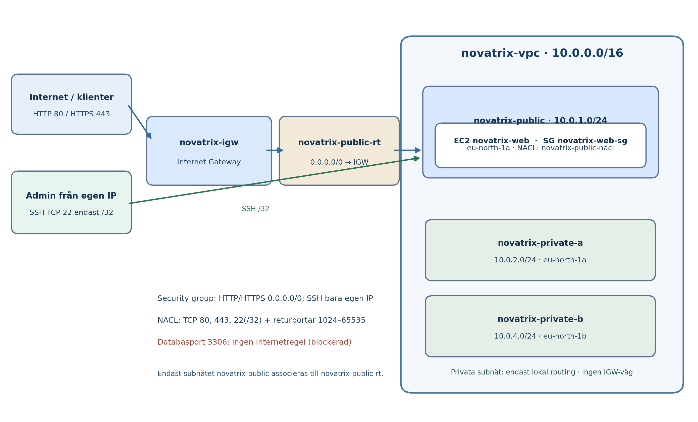

# Vecka 44 - Nätverk och säkerhet (Novatrix AB)

Kurs: Amazon Web Services, MOV25. Genomförande: AWS Management Console, region `eu-north-1`.

## Resursdesign

| Resurs | Namn | Konfiguration |
|---|---|---|
| VPC | `novatrix-vpc` | `10.0.0.0/16` |
| Publikt subnät | `novatrix-public` | `10.0.1.0/24`, `eu-north-1a` |
| Privat A | `novatrix-private-a` | `10.0.2.0/24`, `eu-north-1a` |
| Privat B | `novatrix-private-b` | `10.0.4.0/24`, `eu-north-1b` |
| Internet Gateway | `novatrix-igw` | Attach till `novatrix-vpc` |
| Publik routing | `novatrix-public-rt` | `0.0.0.0/0` till `novatrix-igw`; assoc. bara `novatrix-public` |
| Security Group | `novatrix-web-sg` | TCP 80,443 från 0.0.0.0/0; TCP 22 bara administratörens IP /32 |
| Publik NACL | `novatrix-public-nacl` | TCP 80,443,22(/32) och returportar |
| Temporär AMI | `novatrix-web-v44` | Skapas från `novatrix-web-gammal`, raderas efter verifiering |
| Ny EC2 | `novatrix-web` | Lanseras från AMI i `novatrix-public`, befintlig SSH-nyckel och IAM-rollen `novatrix-ec2-s3-read` |

## Säkerhetsregler och motivering

HTTP TCP/80 och HTTPS TCP/443 kan nås från internet enligt uppgiften. SSH TCP/22 får bara nås från administratörens aktuella publika IPv4 (/32). Security group är stateful; NACL är stateless och kräver svarsregler. TCP/3306 exponeras inte publikt. Privata subnät har bara lokal VPC-routing och saknar direkt internetroute.

NACL inkommande: 100 TCP/80 0.0.0.0/0; 110 TCP/443 0.0.0.0/0; 120 TCP/22 ADMIN-IP/32; 130 TCP/1024-65535 0.0.0.0/0.
NACL utgående: 100 TCP/80 0.0.0.0/0; 110 TCP/443 0.0.0.0/0; 120 TCP/1024-65535 0.0.0.0/0. Övriga trafikslag nekas av sista *-regeln.

## Verifiering

Kommandon finns i `kommandon.txt`. Fyll bara i verkliga resultat när testen genomförts:

- Ny instans finns i `novatrix-vpc` / `novatrix-public`, med ny publik IP.
- HTTP: webbsidan ska svara på port 80.
- HTTPS: port 443 ska vara tillåten i nätverket; för ett faktiskt HTTPS-svar krävs att Apache också konfigureras för TLS. Ett självsignerat testcertifikat är inte betrott för produktion.
- SSH: anslutning från godkänd administratörs-IP ska fungera.
- IAM: `aws sts get-caller-identity` ska visa `novatrix-ec2-s3-read` och S3-läsning ska fungera från instansen.
- Blockerad tjänst: `Test-NetConnection <NY_PUBLIK_IP> -Port 3306` ska visa `TcpTestSucceeded: False`. Detta är ett porttest, inte ett bevis för exakt vilken komponent som blockerar.

## Städa efter verifierad flytt

Avsluta `novatrix-web-gammal` först när nya instansen och S3-rollen fungerar. Avregistrera därefter AMI `novatrix-web-v44` och ta bort dess tillhörande snapshot (om den inte används av andra resurser). Stoppa den nya instansen när labben är klar.

**Säkerhet:** Inga `.pem`-nycklar, privata TLS-nycklar, lösenord eller autentiseringsuppgifter ska finnas i publikt repo.
