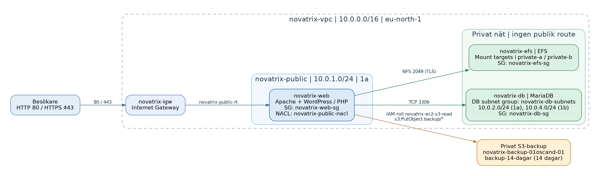

# AWS v45 – Storage och databas (Novatrix AB)

**Kurs:** Amazon Web Services (MOV25)  \
**Vecka:** 45 | Uppgift 4 | Fokus: G

## Arkitektur

Lösningen bygger på `novatrix-vpc` (10.0.0.0/16) med webbservern `novatrix-web` i `novatrix-public` (10.0.1.0/24). RDS-databasen `novatrix-db` använder `novatrix-db-subnets` med privata subnät `novatrix-private-a` (10.0.2.0/24) och `novatrix-private-b` (10.0.4.0/24). `novatrix-efs` har mount targets i båda privata subnäten och monteras med TLS på `/var/www/html/wp-content`.

## Tjänster och säkerhet

| Resurs | Konfiguration |
|---|---|
| RDS | `novatrix-db`, MariaDB, `wordpress`, Public access: No, automatiska backuper: 1 dag |
| DB SG | `novatrix-db-sg`: TCP 3306 enbart från `novatrix-web-sg` |
| EFS | `novatrix-efs`: mount targets i privata subnät |
| EFS SG | `novatrix-efs-sg`: TCP 2049 enbart från `novatrix-web-sg` |
| Webb | `novatrix-web`, Apache + PHP + WordPress |
| S3 | `novatrix-backup-01oscand-01`: privat, Block all public access Enabled |
| Lifecycle | `backup-14-dagar`: prefix `backup/`, expirera aktuella objekt efter 14 dagar |
| IAM | Befintlig EC2-roll `novatrix-ec2-s3-read` kompletterad med `novatrix-s3-backup` |
| NACL | `novatrix-public-nacl`: utgående 3306 och 2049 till 10.0.0.0/16 |

## Motivering (least privilege)

MariaDB och EFS saknar publik exponering. De tar endast emot trafik från webbserverns Security Group. Instansrollen tillåts skriva databasdumpar endast under `backup/` i den privata bucketen och tillåts inte radera dem. S3:s livscykelregel hanterar borttagning efter 14 dagar. För en riktig produktionsmiljö hade jag valt minst sju dagars RDS-backupretention för att ge möjlighet att upptäcka och återställa äldre fel. Kursens Free-plan använder en dag.

## Kommandon och verifiering

Se [`kommandon.txt`](kommandon.txt), [`installera-wordpress.sh`](installera-wordpress.sh), [`backup.sh`](backup.sh) och [`s3-backup-policy.json`](s3-backup-policy.json).

**Efter utförd labb:** Dokumentera de verkliga resultaten för `aws sts get-caller-identity`, `df -h`, ett SQL-SELECT från WordPress-tabellerna och `aws s3 ls s3://novatrix-backup-01oscand-01/backup/`. Ange även aktuell RDS-endpoint i redovisningen i maskerad form och den aktuella webbadressen. Publicera aldrig lösenord, privata SSH-nycklar eller `wp-config.php`.

