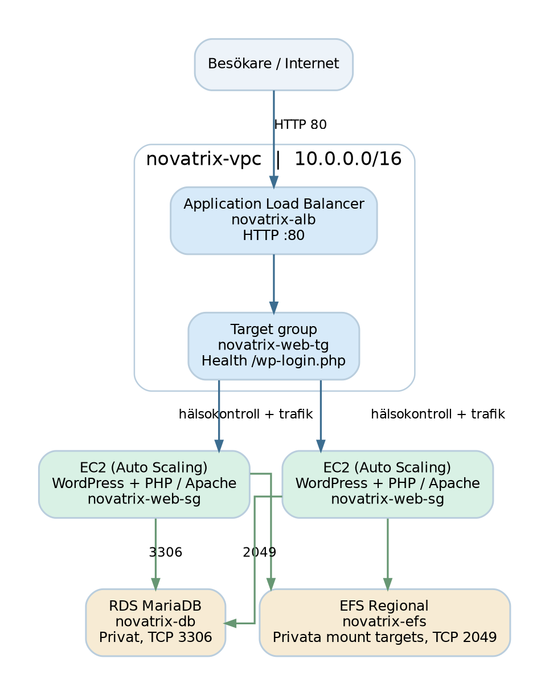

# AWS vecka 47 – Skalbarhet och tillgänglighet

## Översikt
Den befintliga WordPress-miljön för Novatrix AB byggs ut med en Application Load Balancer och en Auto Scaling-grupp över två Availability Zones. Flera EC2-instanser startas från en AMI och delar samma MariaDB-databas i RDS och samma EFS-lagring.

## Resurser
- VPC: `novatrix-vpc` (den VPC som används av WordPress från v45)
- Publika subnät: `novatrix-public` (`10.0.1.0/24`) och `novatrix-public-b` (`10.0.3.0/24`)
- AMI: `novatrix-web-v47`
- Launch template: `novatrix-web-lt`
- Target group: `novatrix-web-tg` (HTTP/80, health check `/wp-login.php`)
- Application Load Balancer: `novatrix-alb`
- Auto Scaling Group: `novatrix-web-asg` (Min 2, Desired 2, Max 4; CPU target tracking 50 %)
- Säkerhetsgrupper: `novatrix-alb-sg`, `novatrix-web-sg`; databas och EFS förblir privata

## Arkitektur

## Praktiskt genomförande
Konfigurationen utförs i AWS Management Console för G, medan `lasttest.sh` och `kommandon.txt` innehåller reproducerbara verifieringskommandon. Den befintliga WordPress-servern behålls tills två ASG-instanser är healthy och failover har verifierats.

## Verifiering
- Två friska targets i olika AZ, WordPress fungerar via ALB DNS.
- CPU-belastning utlöser scaling activity och eventuellt en tredje instans efter CloudWatch-fördröjning.
- En avslutad ASG-instans ersätts, ALB fortsätter att svara.
- AWS Pricing Calculator: jämför två och fyra EC2-instanser under 730 timmar/månad med samma övriga tjänster.

Verifieringsbilder och faktiska resultat dokumenteras i PDF-inlämningen. Inga lösenord, privata nycklar, databasdumpar eller `wp-config.php` lagras här.
